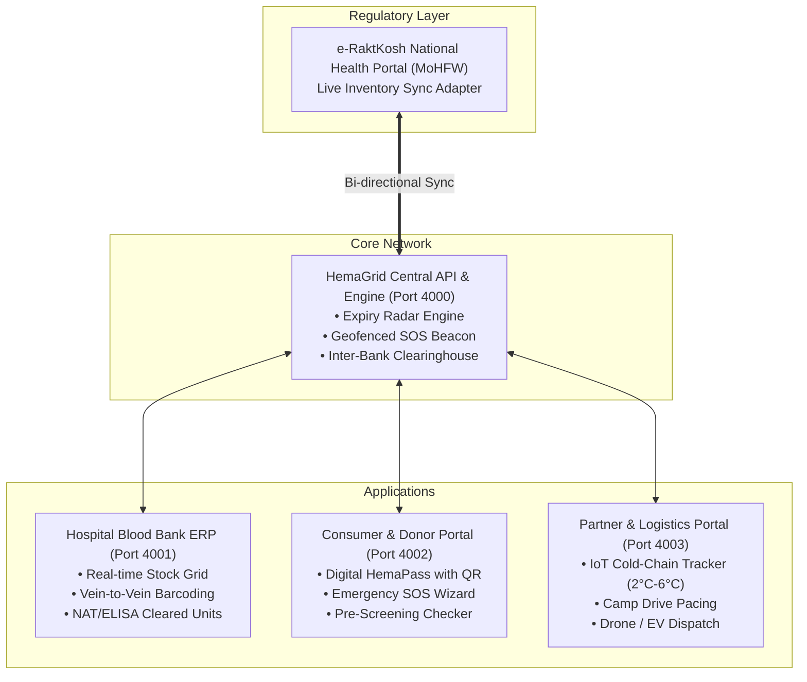

# 🩸 HemaGrid

<div align="center">

[](https://archiboltmusk.github.io/hemagrid/)
[](https://opensource.org/licenses/Apache-2.0)
[](https://nodejs.org/)
[](https://eraktkosh.mohfw.gov.in/)
[](https://nbtc.naco.gov.in/)
[](https://github.com/archiboltmusk/hemagrid/pulls)

**An open-source, full-stack digital blood mesh, hospital ERP, cold-chain IoT tracker, and verified donor network built to solve India's blood crisis.**

[Live Website](https://archiboltmusk.github.io/hemagrid/) • [Architecture](ARCHITECTURE.md) • [Hospital ERP](#1-hospital-blood-bank-erp-port-4001) • [Consumer Portal](#2-consumer--donor-portal-port-4002) • [Logistics & Partners](#3-logistics--cold-chain-iot-portal-port-4003) • [API Engine](#4-central-api--matching-engine-port-4000) • [Emergency Bedside Courier](#bedside-courier-and-ai-ocr)

</div>

---

## 🌟 What Makes HemaGrid the Complete Lifesaving Product

HemaGrid is engineered with empathy and deep understanding of what families, doctors, and blood banks endure at 2:00 AM in Indian hospital corridors:

1. **Take a Deep Breath (Calm Apple-Tier UX):** Zero screaming red alerts that induce panic. Designed with serene dark typography, clear step-by-step guidance, and a soothing reassurance badge.
2. **Instant 90-Minute Digital Hold:** Lock blood units at the hospital counter with a digital reservation token before making the commute.
3. **Emergency Bedside Cold-Chain Courier ("Can't Leave ICU"):** A family member glued to the ICU bedside of a hemorrhaging loved one cannot traverse the city. HemaGrid dispatches a certified thermal-box courier with live IoT temperature probes (2°C – 6°C) and GPS tracking.
4. **AI Doctor Requisition Slip OCR:** Eliminates confusion from hurried, handwritten doctor slips. Upload or snap a picture, and HemaGrid's OCR extracts patient details, required components (PRBC vs Platelets), and matches stock.
5. **Digital Legal Anti-Coercion Shield Pass:** Armed with Supreme Court of India WP 91/1992 and NBTC Rule 14, families can show or play the legal audio pronouncement to corrupt or rigid clerks attempting to deny blood without replacement donors.
6. **Statutory NBTC Price Ceiling Calculator:** Displays official government-mandated price caps (₹1,450 PRBC, ₹400 Platelets, ₹0 for BPL/Ayushman/Thalassemia) with 1-click reporting of extortion to the Drug Controller.
7. **Bilingual (English + हिन्दी) & PWA Offline Support:** Full dynamic translation and service-worker caching so hospital basements with zero reception still provide emergency access.

India collects ~12.5–13 million blood units annually against a requirement of ~14.5–15 million (WHO 1% benchmark). However, the critical crisis is **not just collection—it is systemic fragmentation**:

1. **Forced Replacement Donations:** Despite the 1996 Supreme Court ban on paid donation, hospitals still compel patient attendants to scramble for replacement donors during acute emergencies.
2. **Suboptimal Component Separation:** Whole blood transfusions waste precious fractions. One unit separated into **PRBC**, **Platelets**, and **FFP** can save up to **three lives**.
3. **Platelet Wastage vs. Acute Deficit:** Platelets expire in just **5 days**. Units expire in hospital basements while a facility 8 km away has oncology or dengue patients in critical need.
4. **The Rural-Urban Cold-Chain Divide:** Obstetric hemorrhage in rural PHCs remains a leading maternal killer due to the lack of monitored last-mile delivery.

HemaGrid replaces fragmented data silos with an **active, real-time clearinghouse mesh**.

---

## 🏗️ System Architecture



---

## 📱 The 4 Applications

### 1. Hospital Blood Bank ERP (`Port 4001`)
* **Real-time Component Grid:** Live tracking of PRBC, Platelets (RDP/SDP), Fresh Frozen Plasma (FFP), and Cryoprecipitate.
* **Automated Expiry Radar:** Flags platelets $< 48\text{ hrs}$ and PRBCs $< 7\text{ days}$, automatically matching excess units with nearby hospital demand.
* **Vein-to-Vein Barcode Entry:** Instant barcoding from phlebotomy chair through component separation to bedside cross-matching.
* **e-RaktKosh Sync Health:** Automatic background push ensuring 100% regulatory compliance with zero clerical delay.

### 2. Consumer & Donor Portal (`Port 4002`)
* **Digital HemaPass:** Encrypted mobile donor pass with blood group badges (O-, Rare Bombay Phenotype), lifetime lives-saved counter, and next eligible donation countdown.
* **Verified Emergency SOS (Zero-Spam):** Allows families to trigger emergency blood requests that privately alert verified local donors without leaking personal phone numbers.
* **Interactive Eligibility Checker:** 30-second pre-screener testing age (18–65), weight ($\ge 45\text{ kg}$), hemoglobin ($\ge 12.5\text{ g/dL}$), tattoos, travel, and medications.
* **Camp & Drive Booking:** Direct slot reservation for corporate and university drives to maintain a balanced 365-day donation calendar.

### 3. Logistics & Cold-Chain IoT Portal (`Port 4003`)
* **Live IoT Thermal Sensor Surveillance:** Continuous telemetry monitoring ($2.0^\circ\text{C}$ to $6.0^\circ\text{C}$ for PRBC) with instantaneous thermal breach alerts.
* **GPS & Drone Transit Tracking:** Monitors rapid EV couriers and ICMR-certified rural drone delivery corridors.
* **Camp Drive Management:** Real-time on-site donor throughput, hemoglobin screening stats, and instant digital donor certification.

### 4. Central API & Matching Engine (`Port 4000`)
* **Geofenced SOS Beacon:** Automatically queries donor databases with spatial filters ($\le 7\text{ km}$, verified, $\ge 90\text{ days}$ cooldown) and dispatches focused WhatsApp alerts.
* **Inter-Hospital Clearinghouse:** Automatically generates inter-facility transfer manifests (`MANIFEST-YYYY-XX-####`).
* **IoT Sensor Ingestion:** Ingests live telemetry pings from smart transport boxes.

---

## 📂 Repository Layout

```
hemagrid/
├── ARCHITECTURE.md                  # Deep technical specification & clinical standards
├── README.md                        # Documentation & setup guide
├── package.json                     # Root monorepo orchestrator
│
├── apps/
│   ├── api-server/                  # Express/Node.js central REST & WebSocket API
│   │   ├── src/mockData.js          # Seed dataset (Indian hospitals, units, sensors)
│   │   └── src/server.js            # Core endpoints & matching algorithms
│   │
│   ├── hospital-app/                # Clinical Blood Bank ERP (Vanilla JS + Tailwind)
│   │   ├── public/index.html        # Interactive hospital console
│   │   └── server.js                # Host runner (Port 4001)
│   │
│   ├── consumer-app/                # Voluntary Donor & Patient Portal
│   │   ├── public/index.html        # Digital HemaPass & SOS interface
│   │   └── server.js                # Host runner (Port 4002)
│   │
│   └── partner-app/                 # Fleet, Cold-Chain & Camp Manager
│       ├── public/index.html        # IoT telemetry & live temp graphs
│       └── server.js                # Host runner (Port 4003)
│
└── packages/
    └── shared-types/                # Shared TypeScript contracts & schemas
        └── src/index.ts             # Domain types: BloodGroup, Component, Telemetry
```

---

## 🚀 Quickstart & Local Setup

### 1. Clone & Install
```bash
git clone https://github.com/archiboltmusk/hemagrid.git
cd hemagrid
npm install
```

### 2. Build Shared Contracts
```bash
npm run build --workspace=packages/shared-types
```

### 3. Start the Ecosystem
You can start services individually in separate terminal sessions:

```bash
# Terminal 1: Core API & Matching Engine
npm run dev:api         # -> http://localhost:4000

# Terminal 2: Hospital Blood Bank ERP
npm run dev:hospital    # -> http://localhost:4001

# Terminal 3: Consumer & Donor Portal
npm run dev:consumer    # -> http://localhost:4002

# Terminal 4: Partner & Cold-Chain IoT Monitor
npm run dev:partner     # -> http://localhost:4003
```

---

## 📡 Core API Reference

| Method | Endpoint | Description |
| :--- | :--- | :--- |
| `GET` | `/health` | Health check & service heartbeat. |
| `GET` | `/api/inventory` | Filterable blood inventory (`hospitalId`, `bloodGroup`, `component`). |
| `POST` | `/api/inventory/add` | Register new barcoded unit & auto-sync to e-RaktKosh. |
| `GET` | `/api/expiry-radar` | Real-time units expiring within 48h (Platelets) or 7d (PRBC). |
| `POST` | `/api/transfers/request`| Initiate cold-chain inter-hospital stock transfer. |
| `GET` | `/api/telemetry/:id` | Live IoT temperature, GPS coordinates & battery level. |
| `POST` | `/api/sos/request` | Broadcast geofenced SOS beacon to local verified donors. |
| `GET` | `/api/donors/:id` | Retrieve Digital HemaPass profile & donation history. |
| `GET` | `/api/e-raktkosh/sync-status` | Simulated MoHFW central gateway health. |

---

## ⚖️ Indian Regulatory & Clinical Standards

* **Drugs & Cosmetics Act, 1940 & Rules, 1945 (Part XII-B & Schedule F):** Full compliance with blood banking licensure, storage parameters, and complete ban on paid remuneration.
* **National Blood Transfusion Council (NBTC):** Mandatory screening protocols for 5 TTIs (HIV 1/2, HBV, HCV, Syphilis, Malaria) with support for Nucleic Acid Testing (NAT).
* **Digital Personal Data Protection (DPDP) Act, 2023:** Complete cryptographic privacy for donor health data, strictly prohibiting public phone number directories.

---

## 🤝 Contributing

We welcome contributions from engineers, medical practitioners, transfusion specialists, and healthcare advocates across India:

1. Fork the Project (`https://github.com/archiboltmusk/hemagrid/fork`)
2. Create your Feature Branch (`git checkout -b feature/SmartPlateletAgitator`)
3. Commit your Changes (`git commit -m "feat: add smart platelet agitator telemetry"`)
4. Push to the Branch (`git push origin feature/SmartPlateletAgitator`)
5. Open a Pull Request

---

## 📄 License

Distributed under the **Apache-2.0 License**. See [LICENSE](LICENSE) for details.
